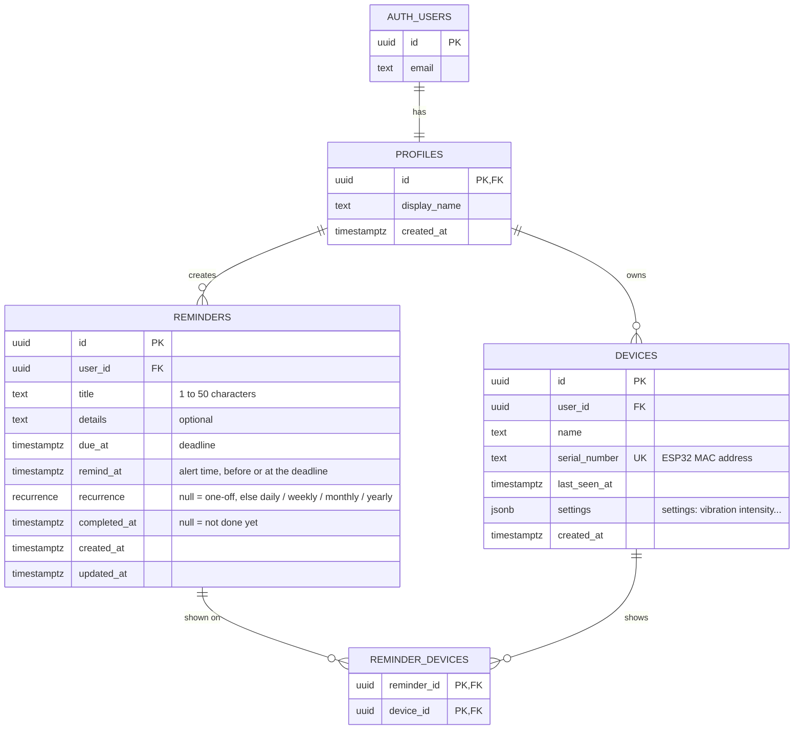

# Database

Supabase database (PostgreSQL). The Expo app writes the reminders, the ESP32 reads them.

- The diagram below renders directly on GitHub, and in VS Code with the *Markdown Preview Mermaid Support* extension.

## Diagram

## Tables

| Table | Purpose |
|---|---|
| `auth.users` | Accounts (email, password). Managed by Supabase, we don't touch it. |
| `profiles` | App-specific user info. Created automatically at sign-up. |
| `devices` | The physical devices (ESP32). |
| `reminders` | The reminders. |
| `reminder_devices` | Which devices each reminder is shown on. |

| Relationship | Type |
|---|---|
| account → profile | 1 – 1 |
| user → devices | 1 – many |
| user → reminders | 1 – many |
| reminder ↔ devices | many – many, through `reminder_devices` |

A reminder belongs to the user, not to a device. It can be shown on several devices (e.g. one on the desk and one in the bedroom), or on none: it then only shows in the app. Deleting a device does not delete its reminders, only the links.

A reminder shown on several devices is marked as done everywhere as soon as the button of one of them is pressed.

## Reminders

| Column | Purpose |
|---|---|
| `due_at` | The deadline (e.g. assignment due Monday 11:59 pm). |
| `remind_at` | When the device alerts (e.g. Sunday 6 pm). Always before or equal to `due_at`. |
| `recurrence` | `null` for a one-off reminder, otherwise `daily` / `weekly` / `monthly` / `yearly`. |
| `completed_at` | `null` until it is done. |

Marking as done (`complete_reminder` function, used by the app and by the ESP32):

- **one-off reminder**: `completed_at = now()`, it disappears from the device;
- **recurring reminder**: `due_at` and `remind_at` move forward together by one period until they are in the future. `completed_at` stays `null`.

The title is 1 to 50 characters long.

## Device settings

A device's settings are stored in `devices.settings`, a JSON object. Current settings:

| Key | Type | Default | Purpose |
|---|---|---|---|
| `vibration_intensity` | number 0–100 | 50 | Vibration strength |

To add a setting, handle it in the app and in the ESP32 code (with a default value if the key is missing), then add it to this table.

## Dates

Dates are `timestamptz` (date + time with time zone), stored in UTC.

## Security

Each user can only read and change their own rows (Row Level Security).

| Table | The app can... |
|---|---|
| `profiles` | read, update (created by the trigger, deleted with the account) |
| `devices` | read, update, delete. **Not create**: a device is only created by pairing, otherwise anyone could claim someone else's serial number. |
| `reminders` | everything |
| `reminder_devices` | read, create, delete, only if both the reminder **and** the device belong to the user |

During development, before pairing exists, devices are created by hand in Supabase (Table Editor or SQL Editor), which bypasses RLS.
