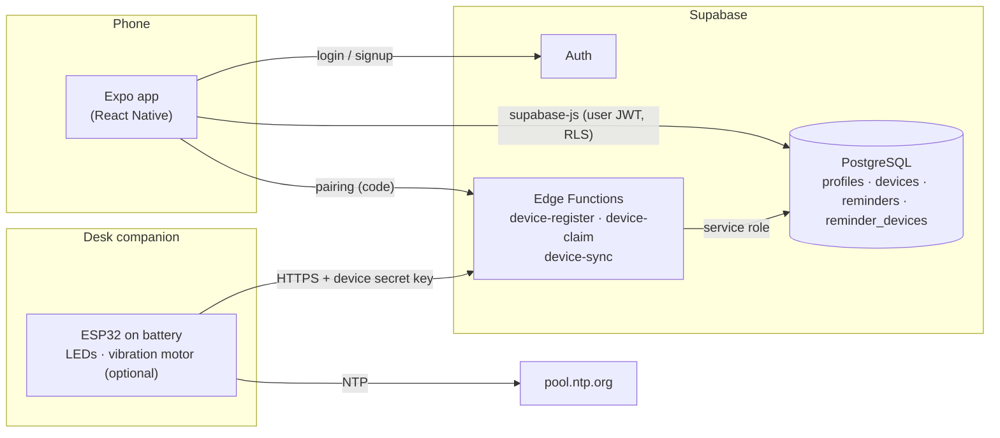
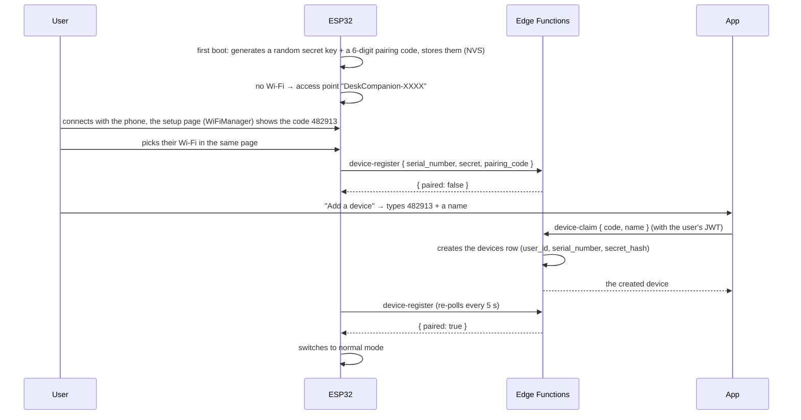
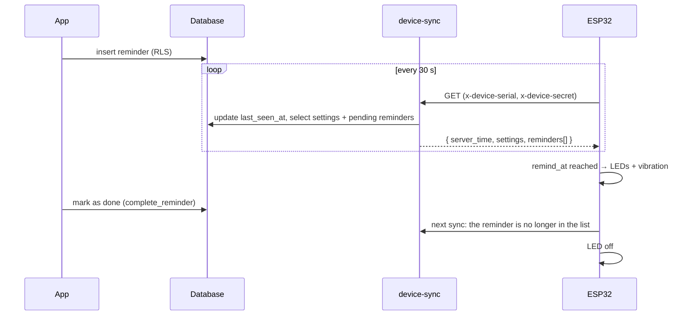
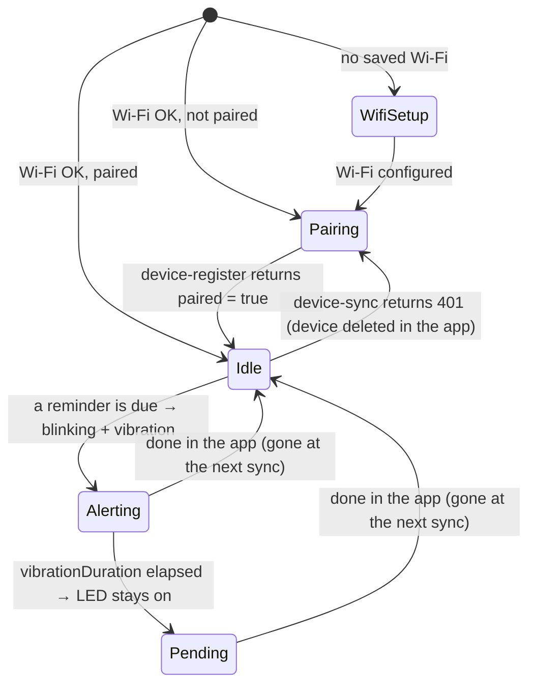

# Architecture

Project overview: who does what, how the parts talk to each other, and the methods to write on each side.

The need (see `survey_report.pdf`): 44% of students want an easy phone connection, and sound alarms are seen as too overwhelming. Hence the MVP:

- create reminders in the app;
- sync them to the device;

## Overview



Three blocks, three ways to access the data:

| Block | Tech | Data access |
|---|---|---|
| App | Expo + `@supabase/supabase-js` | Directly on the tables, with the user's account. RLS ensures they only see their own rows. |
| Backend | Supabase (Auth, PostgreSQL, Edge Functions) | — |
| Device | ESP32 (Arduino), `HTTPClient` + `ArduinoJson` | **Never directly on the tables.** Only through the Edge Functions, identifying itself with its serial number + secret key. It can only read its own reminders. |

The ESP32 has no user account, which is why it goes through functions: they check its key, then read the database with admin rights (service role), filtering on its `device_id`.

## Main flows

### 1. Pairing (linking an ESP32 to a user)

The device needs no screen for this: on first boot it opens a Wi-Fi access point, the user connects to it with their phone, and the setup page (where they choose their Wi-Fi) also shows a 6-digit pairing code. The user then types that code in the app.



### 2. Syncing reminders

Simple polling: every 30 s, the ESP32 asks for its upcoming reminders. It keeps the list in memory, so it still alerts if the Wi-Fi drops between two calls.



### 3. Marking a reminder as done

Only from the app: the device has no button. The app calls the SQL function `complete_reminder`, which handles recurrence:

- one-off reminder → `completed_at = now()`;
- recurring reminder → `due_at` and `remind_at` move to the next occurrence (next day / week / month / year), `completed_at` stays `null`.

The device sees it at its next sync (at most 30 s later): the reminder is gone from the list (or, if recurring, its `remind_at` moved forward), so the LED turns off.

## Database

See `database/schema.md`. Done for the device: `devices.secret_hash` (authenticates the ESP32) and a nullable `devices.user_id` (the ESP32 registers itself before being paired). Still to add:

- pairing (code typed in the app → sets `devices.user_id`);
- the `complete_reminder(reminder_id uuid)` function.

## Edge Functions (Supabase, TypeScript / Deno)

Folder: `supabase/functions/<name>/index.ts`, shared code in `supabase/functions/_shared/device.ts`. Deploy with `npx supabase functions deploy`.

| Function | Called by | Auth | Input | Output |
|---|---|---|---|---|
| `device-register` | ESP32 | `apikey` + `x-device-serial` + `x-device-secret` (first contact: creates the row) | — (POST) | `{ registered: true, paired }`, `409` if the serial is known with another secret. Pairing code: to add |
| `device-claim` | App | user JWT | `{ code, name }` | the created `devices` row |
| `device-sync` | ESP32 | `apikey` + `x-device-serial` + `x-device-secret` | — | `{ server_time, settings, reminders: [{ id, title, remind_at }] }` — times in **Unix seconds** (UTC), not ISO strings, so the ESP32 has no date parsing to do |

The two device functions (`device-register`, `device-sync`) are deployed with `verify_jwt = false` (in `supabase/config.toml`): the ESP32 has no user JWT. They use `withSupabase({ auth: "publishable" })` from `@supabase/server`: the `apikey` header must be the project's publishable key (not secret, it only filters unknown clients), then the functions check the device secret themselves and read the database with `ctx.supabaseAdmin` (service role).

Shared method: `authenticateDevice(admin, req): Promise<Device | null>` — reads both headers, compares `sha256(secret)` with `devices.secret_hash`, the function returns 401 when it is `null`.

`device-sync` only returns pending reminders linked to this device (through `reminder_devices`), sorted by `remind_at`, limited (e.g. 20) to fit in the ESP32's RAM.

## App (Expo)

### File tree

```
app/src/
├── app/                          ← screens (Expo Router)
│   ├── _layout.tsx               ← root Stack + redirect logged in / logged out (useSession)
│   ├── (auth)/                   ← no tabs, only reachable when logged out
│   │   ├── _layout.tsx
│   │   ├── login.tsx             ← email + password
│   │   └── signup.tsx            ← email + password (display name set by the SQL trigger)
│   ├── (tabs)/                   ← only reachable when logged in
│   │   ├── _layout.tsx           ← tabs: Home · Calendar · Reminders · Settings
│   │   ├── index.tsx             ← home: next reminders, all devices
│   │   ├── calendar.tsx          ← reminders by day
│   │   ├── reminders.tsx         ← full list, mark as done, "+" button
│   │   └── settings.tsx          ← display name, device list, log out
│   ├── reminders/                ← pushed on top of the tabs (no tab bar)
│   │   ├── new.tsx               ← creation form (?deviceId=…)
│   │   └── [id].tsx              ← edit / delete
│   └── devices/
│       ├── pair.tsx              ← pairing code input
│       └── [id].tsx              ← name, vibration intensity, delete
├── components/                   ← reusable UI, never in app/
│   ├── reminder-card.tsx
│   ├── reminder-form.tsx         ← shared by reminders/new.tsx and reminders/[id].tsx
│   └── device-card.tsx
├── lib/
│   └── supabase.ts               ← createClient + session storage
├── services/                     ← every Supabase call, nothing else
│   ├── auth.ts
│   ├── profile.ts
│   ├── devices.ts
│   └── reminders.ts
├── hooks/
│   ├── use-session.ts
│   ├── use-devices.ts
│   └── use-reminders.ts
├── types/
│   └── models.ts                 ← Profile, Device, Reminder... (see below)
└── constants/                    ← colors, sizes, sync interval...
```

Simple rule: **screens never call Supabase directly**. Screen → hook → service → Supabase. If the database changes, only `services/` changes.

Navigation: no screen navigates after login or logout. `signIn` / `signOut` change the session, `onAuthChange` fires, and the root `_layout.tsx` redirects to `(tabs)` or `(auth)`.

Screens outside `(tabs)/` (`reminders/`, `devices/`) are opened with `router.push` and show a back button instead of the tab bar. Keep them out of `(tabs)/`: every file in that folder becomes a tab.

Environment variables go in `app/.env.local` (ignored by git): `EXPO_PUBLIC_SUPABASE_URL` and `EXPO_PUBLIC_SUPABASE_KEY` (publishable key, never the secret one). Only variables starting with `EXPO_PUBLIC_` reach the app. Restart `npx expo start` after changing them.

Packages: `@supabase/supabase-js` and `@react-native-async-storage/async-storage` (keep the session) are installed. Still to add with `npx expo install`: `@react-native-community/datetimepicker` (date/time picker).

### Service methods

```ts
// types/models.ts
type Recurrence = 'daily' | 'weekly' | 'monthly' | 'yearly';

type Profile = {
  id: string;                // same as the auth.users id
  display_name: string;      // never null (default: email before the @)
  created_at: string;        // ISO, UTC
};

type Device = {
  id: string;
  name: string;
  serial_number: string;
  last_seen_at: string | null;
  settings: { vibration_intensity: number };
};

type Reminder = {
  id: string;
  title: string;             // 1 to 50 characters
  details: string | null;
  due_at: string;            // ISO, UTC
  remind_at: string;         // ISO, UTC, <= due_at
  recurrence: Recurrence | null;
  completed_at: string | null;
  device_ids: string[];      // devices it is shown on (reminder_devices table)
};

type ReminderInput = Pick<Reminder, 'title' | 'details' | 'due_at' | 'remind_at' | 'recurrence' | 'device_ids'>;
```

```ts
// services/auth.ts
signUp(email: string, password: string): Promise<void>                 // display_name = part of the email before @ (SQL trigger)
signIn(email: string, password: string): Promise<void>
signOut(): Promise<void>
getSession(): Promise<Session | null>
onAuthChange(callback: (session: Session | null) => void): () => void   // returns unsubscribe

// services/profile.ts
getProfile(): Promise<Profile>
updateProfile(patch: { display_name?: string }): Promise<Profile>

// services/devices.ts
listDevices(): Promise<Device[]>
getDevice(id: string): Promise<Device>
claimDevice(code: string, name: string): Promise<Device>               // → Edge Function device-claim
renameDevice(id: string, name: string): Promise<Device>
updateDeviceSettings(id: string, settings: Partial<Device['settings']>): Promise<Device>
deleteDevice(id: string): Promise<void>                                // reminders stay, only the links are deleted
isDeviceOnline(device: Device): boolean                                // last_seen_at < 2 min

// services/reminders.ts
listUpcomingReminders(): Promise<Reminder[]>                           // all devices, pending, sorted by due_at
listDeviceReminders(deviceId: string, opts?: { includeCompleted?: boolean }): Promise<Reminder[]>
getReminder(id: string): Promise<Reminder>
createReminder(input: ReminderInput): Promise<Reminder>               // insert reminders + reminder_devices
updateReminder(id: string, patch: Partial<ReminderInput>): Promise<Reminder>
setReminderDevices(id: string, deviceIds: string[]): Promise<void>     // replaces the reminder_devices links
deleteReminder(id: string): Promise<void>
completeReminder(id: string): Promise<Reminder>                        // → rpc('complete_reminder')
uncompleteReminder(id: string): Promise<Reminder>                      // completed_at = null
```

### Hooks

```ts
useSession(): { session: Session | null; loading: boolean }
useDevices(): { devices: Device[]; loading: boolean; error: Error | null; refresh(): Promise<void> }
useReminders(deviceId?: string): { reminders: Reminder[]; loading: boolean; error: Error | null; refresh(): Promise<void> }
```

## Firmware (ESP32)

PlatformIO project (open the `firmware/` folder itself in VS Code). One module per responsibility: prototypes in `include/*.h`, code in `src/*.cpp`. Libraries (WiFiManager, ArduinoJson v7) are listed in `platformio.ini` and downloaded automatically.

```
firmware/
├── platformio.ini    ← board, libraries, Serial speed
├── include/
│   ├── config.h          ← pins, timeouts, sync interval, Edge Function paths
│   ├── secrets.h         ← Wi-Fi credentials, Supabase URL + publishable key (ignored by git)
│   ├── types.h           ← shared structs (Reminder)
│   ├── wifi_connection.h ← Wi-Fi + time (NTP)
│   ├── sync_client.h     ← device secret (NVS) + Edge Function calls (register, sync) + JSON parsing
│   ├── reminders.h       ← local list + due detection
│   └── alerts.h          ← LED + vibration motor
└── src/
    ├── main.cpp      ← setup() + loop()
    └── <module>.cpp  ← one per header above (config.h, secrets.h and types.h have none)
```

### State machine



### Methods

The prototypes, with their documentation, are in `firmware/include/*.h`.

In `loop()`: never a long `delay()`. Compare `millis()` to know when to resync (30 s) and to animate the LEDs, otherwise the blinking freezes during waits.

Power: the device runs on a battery, and Wi-Fi is what drains it. Measure the battery life with a 30 s sync first; if it is too short, increase `SYNC_INTERVAL_MS` or put the ESP32 in light / deep sleep between syncs (later).

## Work order

Consistent with the roadmap in the report:

| Step | Content | Depends on |
|---|---|---|
| 1 | Tables + SQL additions above in Supabase, test data | — |
| 2 | `lib/supabase.ts`, `services/auth.ts`, login / signup screens | 1 |
| 3 | `services/reminders.ts` + `devices.ts`, reminder / device screens (with a device created by hand in SQL) | 2 |
| 4 | Edge Function `device-sync`, tested with `curl` | 1 |
| 5 | Firmware: Wi-Fi, NTP, LEDs (Fab Lab) | — |
| 6 | Firmware: `api` + `reminders` + alerts | 4, 5 |
| 7 | Pairing: `device-register`, `device-claim`, `pair.tsx` screen | 3, 6 |

Pairing comes last: in the meantime, the device can be created by hand in Supabase and its key flashed into the ESP32, which unblocks the app and the firmware in parallel.
