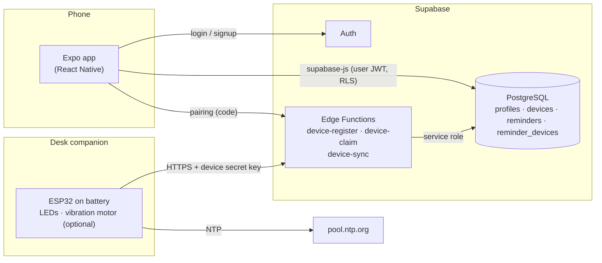
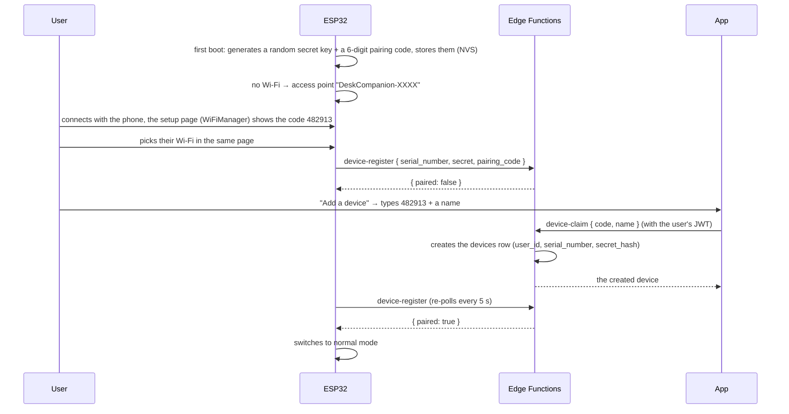
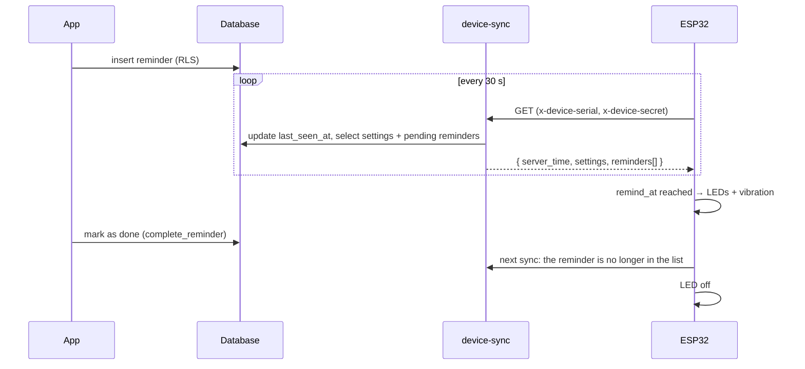
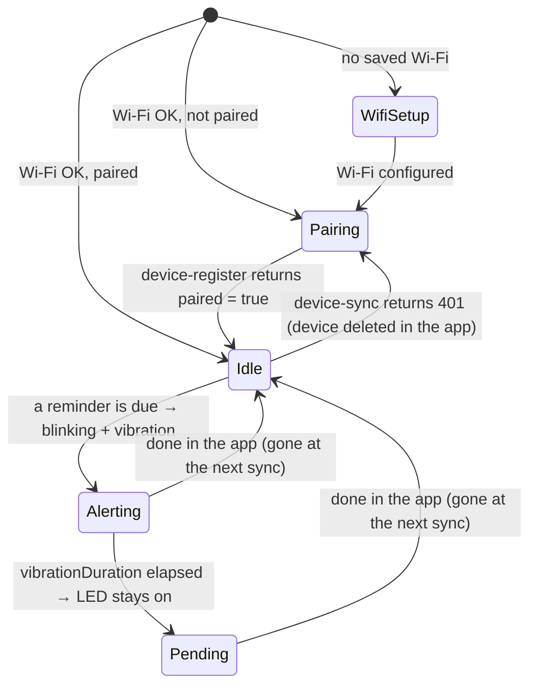

# Architecture

Project overview: who does what, how the parts talk to each other, and the methods to write on each side.

The need (see `survey_report.pdf`): 44% of students want an easy phone connection, and sound alarms are seen as too overwhelming. Hence the MVP:

- create reminders in the app;
- sync them to the device;

## Overview



Three blocks, three ways to access the data:

| Block | Tech | Data access |
|---|---|---|
| App | Expo + `@supabase/supabase-js` | Directly on the tables, with the user's account. RLS ensures they only see their own rows. |
| Backend | Supabase (Auth, PostgreSQL, Edge Functions) | — |
| Device | ESP32 (Arduino), `HTTPClient` + `ArduinoJson` | **Never directly on the tables.** Only through the Edge Functions, identifying itself with its serial number + secret key. It can only read its own reminders. |

The ESP32 has no user account, which is why it goes through functions: they check its key, then read the database with admin rights (service role), filtering on its `device_id`.

## Main flows

### 1. Pairing (linking an ESP32 to a user)

The device needs no screen for this: on first boot it opens a Wi-Fi access point, the user connects to it with their phone, and the setup page (where they choose their Wi-Fi) also shows a 6-digit pairing code. The user then types that code in the app.



### 2. Syncing reminders

Simple polling: every 30 s, the ESP32 asks for its upcoming reminders. It keeps the list in memory, so it still alerts if the Wi-Fi drops between two calls.



### 3. Marking a reminder as done

Only from the app: the device has no button. The app calls the SQL function `complete_reminder`, which handles recurrence:

- one-off reminder → `completed_at = now()`;
- recurring reminder → `due_at` and `remind_at` move to the next occurrence (next day / week / month / year, or the next chosen day of the week), `completed_at` stays `null`.

The device sees it at its next sync (at most 30 s later): the reminder is gone from the list (or, if recurring, its `remind_at` moved forward), so the LED turns off.

## Database

See `database/schema.md`. Done: `devices.secret_hash` (authenticates the ESP32), a nullable `devices.user_id` (the ESP32 registers itself before being paired), the full default of `devices.settings`, `reminders.recurrence_days` (repeat on chosen days of the week), and the `complete_reminder(reminder_id uuid, time_zone text)` function. Still to add:

- pairing (code typed in the app → sets `devices.user_id`).

`database/schema.sql` creates a new database. A database created with an older version is updated with the files of `database/migrations/`, run once each, in order, in the SQL Editor.

## Edge Functions (Supabase, TypeScript / Deno)

Folder: `supabase/functions/<name>/index.ts`, shared code in `supabase/functions/_shared/device.ts`. Deploy with `npx supabase functions deploy`.

| Function | Called by | Auth | Input | Output |
|---|---|---|---|---|
| `device-register` | ESP32 | `apikey` + `x-device-serial` + `x-device-secret` (first contact: creates the row) | — (POST) | `{ registered: true, paired }`, `409` if the serial is known with another secret. Pairing code: to add |
| `device-claim` | App | user JWT | `{ code, name }` | the created `devices` row |
| `device-sync` | ESP32 | `apikey` + `x-device-serial` + `x-device-secret` | — | `{ server_time, settings, reminders: [{ id, title, remind_at }] }` — times in **Unix seconds** (UTC), not ISO strings, so the ESP32 has no date parsing to do |

The two device functions (`device-register`, `device-sync`) are deployed with `verify_jwt = false` (in `supabase/config.toml`): the ESP32 has no user JWT. They use `withSupabase({ auth: "publishable" })` from `@supabase/server`: the `apikey` header must be the project's publishable key (not secret, it only filters unknown clients), then the functions check the device secret themselves and read the database with `ctx.supabaseAdmin` (service role).

Shared method: `authenticateDevice(admin, req): Promise<Device | null>` — reads both headers, compares `sha256(secret)` with `devices.secret_hash`, the function returns 401 when it is `null`.

`device-sync` only returns pending reminders linked to this device (through `reminder_devices`), sorted by `remind_at`, limited (e.g. 20) to fit in the ESP32's RAM.

## App (Expo)

### File tree

```
app/src/
├── app/                          ← screens (Expo Router)
│   ├── _layout.tsx               ← fonts, providers, redirect logged in / logged out
│   ├── (auth)/                   ← no tabs, only reachable when logged out
│   │   ├── _layout.tsx           ← opens on login
│   │   ├── login.tsx             ← email + password
│   │   └── signup.tsx            ← first name + email + password
│   ├── (tabs)/                   ← only reachable when logged in
│   │   ├── _layout.tsx           ← floating tab bar: Today · Reminders · Calendar · Settings
│   │   ├── index.tsx             ← Today: next reminder, the following ones, devices summary
│   │   ├── reminders.tsx         ← list by day, search, filter (status, one-off / repeating), sort, "+" button
│   │   ├── calendar.tsx          ← month grid + reminders and calendar events of the selected day
│   │   └── settings.tsx          ← profile (edit name), language, devices, add a device, calendars, sign out
│   ├── reminders/                ← pushed on top of the tabs (no tab bar)
│   │   ├── new.tsx               ← creation form (modal)
│   │   └── [id].tsx              ← edit, mark as done, delete
│   └── devices/
│       ├── pair.tsx              ← pairing code input (modal)
│       └── [id].tsx              ← name, vibration, light, remove
│   └── calendars.tsx             ← link phone calendars and .ics links
├── components/                   ← reusable UI, never in app/
│   ├── ui/                       ← generic: Button, TextField, Card, Screen, TopBar, Chip, Toggle,
│   │                               Stepper, DateTimeField, CodeInput, Notice, Badge...
│   ├── AuthLayout.tsx            ← frame of login / signup
│   ├── ReminderForm.tsx          ← shared by reminders/new.tsx and reminders/[id].tsx
│   ├── ReminderRow.tsx · EventRow.tsx · DeviceRow.tsx · MonthCalendar.tsx · TabBarIcon.tsx
├── lib/
│   ├── supabase.ts               ← createClient + session storage
│   └── recurrence.ts             ← repeat labels, days of the week
├── services/                     ← every Supabase call, nothing else
│   ├── auth.ts · profile.ts · devices.ts · reminders.ts
│   ├── calendars.ts              ← outside calendars (phone + .ics), no Supabase
├── hooks/                        ← state shared by the screens (React contexts)
│   ├── useAuth.tsx · useProfile.tsx · useReminders.tsx · useDevices.tsx · useCalendarEvents.tsx
│   ├── useLanguage.tsx           ← app language (en / fr), saved on the phone
│   └── useActionError.ts         ← turns a failed action into a message
├── i18n/                         ← en.ts (reference texts) · fr.ts (same keys, checked by TypeScript)
├── types/
│   ├── database.ts               ← generated (npx supabase gen types), never edited by hand
│   └── models.ts                 ← Profile, Device, Reminder... built on database.ts
└── constants/                    ← Colors, Fonts
```

Simple rule: **only `services/` imports the Supabase client**. Screens read the data through the hooks (screen → hook → service → Supabase) and call a service directly only for one-off actions (sign in, sign out). If the database changes, only `services/` changes.

Navigation: no screen navigates after login or logout. `signInWithEmail` / `signOut` change the session, `onAuthChange` fires, and the root `_layout.tsx` redirects to `(tabs)` or `(auth)`.

Screens outside `(tabs)/` (`reminders/`, `devices/`) are opened with `router.push` and show a back button (`TopBar`) instead of the tab bar. They are declared in the root `_layout.tsx`, inside the logged-in `Stack.Protected`. Keep them out of `(tabs)/`: every file in that folder becomes a tab. With typed routes, a dynamic screen is opened with `router.push({ pathname: '/reminders/[id]', params: { id } })`.

Environment variables go in `app/.env.local` (ignored by git): `EXPO_PUBLIC_SUPABASE_URL` and `EXPO_PUBLIC_SUPABASE_KEY` (publishable key, never the secret one). Only variables starting with `EXPO_PUBLIC_` reach the app. Restart `npx expo start` after changing them.

Packages added with `npx expo install`: `@supabase/supabase-js`, `@react-native-async-storage/async-storage` (keeps the session), `@expo/vector-icons` (Feather icons), `@react-native-community/datetimepicker` (date/time picker), `@expo-google-fonts/fredoka` and `@expo-google-fonts/nunito`, `expo-calendar` (phone calendars). With npm: `ical.js` (.ics parser: repeating events, time zones).

### Outside calendars

Read-only: events of linked calendars show in the Calendar tab (teal dot, color bar) but are not reminders, are not stored in Supabase and are not sent to the device.

- **Phone calendars** (`expo-calendar/legacy`, the new API is not in Expo Go): every calendar of an account set up on the phone (Google, iCloud, Outlook). No OAuth needed. Not available on web.
- **.ics links**: a subscription URL (Google "secret address in iCal format", iCloud public calendar, school timetable), downloaded and expanded from 2 months ago to 12 months ahead. The phone downloads it directly; on web it goes through the `ics-proxy` Edge Function (logged-in users only), because most calendar servers send no CORS headers.
- The choices (calendar ids, links) are saved on the phone in AsyncStorage, per user (`calendar-settings:<user id>`).

### Types

`types/models.ts` builds the app types on the generated ones (`Tables<'reminders'>`...). Dates are ISO strings in UTC.

```ts
type Recurrence = 'daily' | 'weekly' | 'monthly' | 'yearly';
type Profile = Tables<'profiles'>;              // id, display_name, created_at
type Reminder = Tables<'reminders'>;            // title 1-50 chars, remind_at <= due_at, completed_at null = to do
type ReminderInput = Pick<TablesInsert<'reminders'>, 'title' | 'details' | 'due_at' | 'remind_at' | 'recurrence' | 'recurrence_days'>;
type DeviceSettings = {
  vibration_enabled: boolean; vibration_intensity: number; vibration_duration: number;
  led_enabled: boolean; led_color: string; led_brightness: number;
};
type Device = Omit<Tables<'devices'>, 'secret_hash' | 'settings'> & { settings: DeviceSettings };
```

The devices a reminder is shown on are not in `Reminder`: they are read with `getReminderDeviceIds` and written with `setReminderDevices`.

### Service methods

Every method throws an `Error` if Supabase fails (the auth ones throw the `AuthError`, so the screens can read its `code`).

```ts
// services/auth.ts
signUpWithEmail(email, password, displayName): Promise<{ session, user }>   // session null = email to confirm
signInWithEmail(email, password): Promise<{ session, user }>
signOut(): Promise<void>
onAuthChange(callback: (session: Session | null) => void): () => void      // returns unsubscribe

// services/profile.ts
getProfile(userId): Promise<Profile>
updateProfile(userId, updates: { display_name }): Promise<Profile>

// services/devices.ts
claimDevice(code, name): Promise<Device>                                   // → Edge Function device-claim (not written yet)
getDevices(userId): Promise<Device[]>                                      // sorted by name, never returns secret_hash
getDevice(userId, deviceId): Promise<Device>
updateDevice(userId, deviceId, { name?, settings?: Partial<DeviceSettings> }): Promise<Device>  // settings merged
deleteDevice(userId, deviceId): Promise<void>                              // reminders stay, only the links are deleted
isDeviceOnline(device): boolean                                            // last_seen_at < 5 min

// services/reminders.ts
createReminder(userId, input: ReminderInput): Promise<Reminder>
getReminders(userId, includeCompleted = false): Promise<Reminder[]>       // sorted by due_at
getReminder(userId, reminderId): Promise<Reminder>
updateReminder(userId, reminderId, updates: Partial<ReminderInput>): Promise<Reminder>
getReminderDeviceIds(reminderId): Promise<string[]>
setReminderDevices(reminderId, deviceIds): Promise<void>                   // replaces the reminder_devices links
completeReminder(reminderId): Promise<Reminder>                            // → rpc('complete_reminder')
deleteReminder(userId, reminderId): Promise<void>
isReminderCompleted(reminder): boolean
```

### Hooks

The data hooks are React contexts: each provider loads its data once and shares it with every screen, so an action done on one tab shows on the others right away. The providers are in the root `_layout.tsx`, under `AuthProvider`, with `key={user.id}`: a new account starts from empty state.

```ts
useAuth(): { session: Session | null; user: User | null; isLoading: boolean }
useProfile(): { profile: Profile | null; isLoading: boolean }               // falls back to the signup name
useReminders(): {
  reminders: Reminder[];   // done ones included, sorted by due_at
  isLoading: boolean;      // only the first load
  error: string | null;
  refresh(): void;
  complete(reminderId): Promise<void>;
  create(input, deviceIds?): Promise<void>;
  update(reminderId, changes, deviceIds?): Promise<void>;   // deviceIds left out = links unchanged
  remove(reminderId): Promise<void>;
}
useDevices(): {
  devices: Device[]; isLoading: boolean; error: string | null; refresh(): void;
  update(deviceId, { name?, settings? }): Promise<void>;
  remove(deviceId): Promise<void>;
  claim(code, name): Promise<void>;
}
useActionError(): { actionError: string | null; run(action, message): Promise<boolean>; clearActionError(): void }
```

- `useReminders` and `useDevices` reload by themselves when the app comes back to the foreground (`AppState`), to show what changed meanwhile (online status, a reminder the device marked as done).
- Their actions don't catch errors: the screen wraps them with `run(...)` from `useActionError`, which shows a `Notice` and returns `false` if the action failed.

## Firmware (ESP32)

PlatformIO project (open the `firmware/` folder itself in VS Code). One module per responsibility: prototypes in `include/*.h`, code in `src/*.cpp`. Libraries (WiFiManager, ArduinoJson v7) are listed in `platformio.ini` and downloaded automatically.

```
firmware/
├── platformio.ini    ← board, libraries, Serial speed
├── include/
│   ├── config.h          ← pins, timeouts, sync interval, Edge Function paths
│   ├── secrets.h         ← Wi-Fi credentials, Supabase URL + publishable key (ignored by git)
│   ├── types.h           ← shared structs (Reminder)
│   ├── wifi_connection.h ← Wi-Fi + time (NTP)
│   ├── sync_client.h     ← device secret (NVS) + Edge Function calls (register, sync) + JSON parsing
│   ├── reminders.h       ← local list + due detection
│   └── alerts.h          ← LED + vibration motor
└── src/
    ├── main.cpp      ← setup() + loop()
    └── <module>.cpp  ← one per header above (config.h, secrets.h and types.h have none)
```

### State machine



### Methods

The prototypes, with their documentation, are in `firmware/include/*.h`.

In `loop()`: never a long `delay()`. Compare `millis()` to know when to resync (30 s) and to animate the LEDs, otherwise the blinking freezes during waits.

Power: the device runs on a battery, and Wi-Fi is what drains it. Measure the battery life with a 30 s sync first; if it is too short, increase `SYNC_INTERVAL_MS` or put the ESP32 in light / deep sleep between syncs (later).

## Work order

Consistent with the roadmap in the report:

| Step | Content | Depends on |
|---|---|---|
| 1 | Tables + SQL additions above in Supabase, test data | — |
| 2 | `lib/supabase.ts`, `services/auth.ts`, login / signup screens | 1 |
| 3 | `services/reminders.ts` + `devices.ts`, reminder / device screens (with a device created by hand in SQL) | 2 |
| 4 | Edge Function `device-sync`, tested with `curl` | 1 |
| 5 | Firmware: Wi-Fi, NTP, LEDs (Fab Lab) | — |
| 6 | Firmware: `api` + `reminders` + alerts | 4, 5 |
| 7 | Pairing: `device-register`, `device-claim`, `pair.tsx` screen | 3, 6 |

Pairing comes last: in the meantime, the device can be created by hand in Supabase and its key flashed into the ESP32, which unblocks the app and the firmware in parallel.
