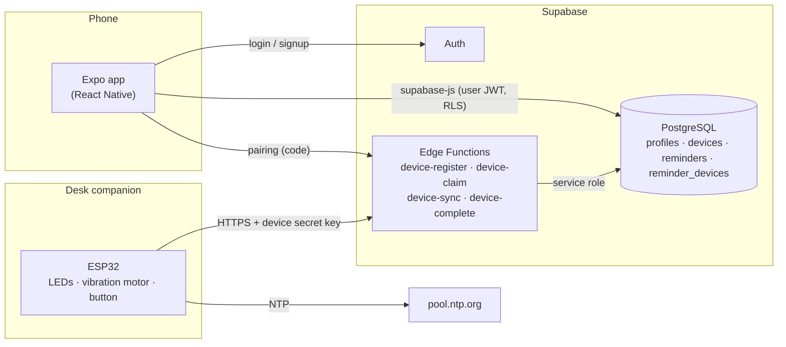
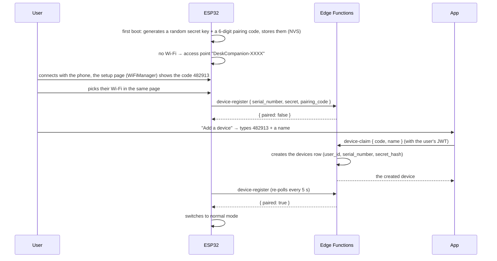
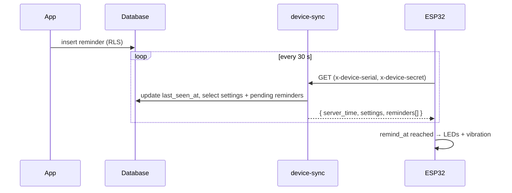
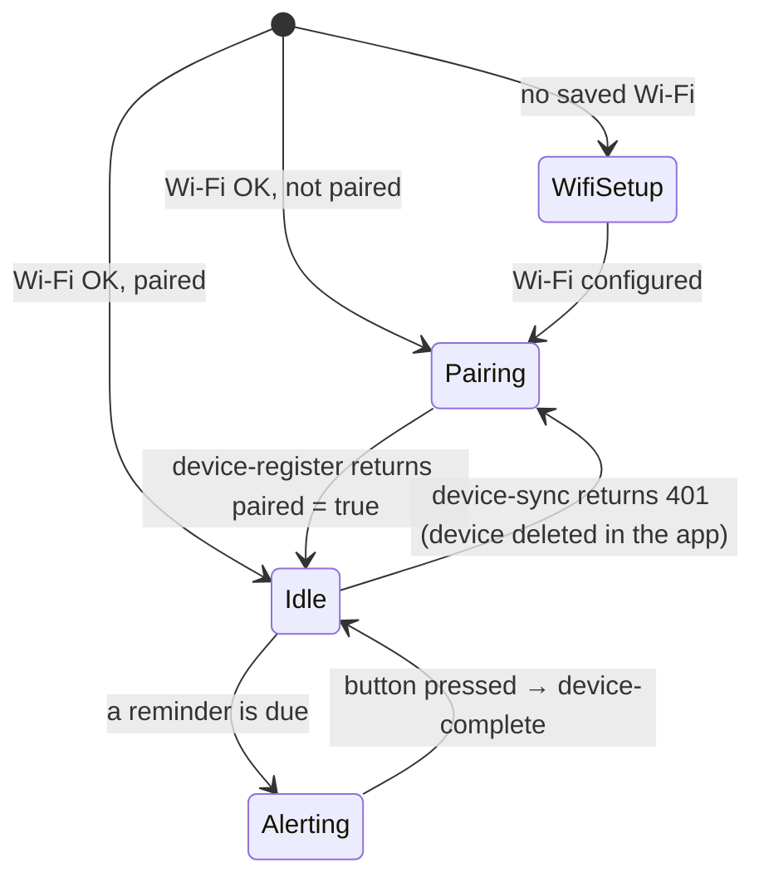

# Architecture

Project overview: who does what, how the parts talk to each other, and the methods to write on each side.

The need (see `survey_report.pdf`): 44% of students want an easy phone connection, and sound alarms are seen as too overwhelming. Hence the MVP:

- create reminders in the app;
- sync them to the device;

## Overview



Three blocks, three ways to access the data:

| Block | Tech | Data access |
|---|---|---|
| App | Expo + `@supabase/supabase-js` | Directly on the tables, with the user's account. RLS ensures they only see their own rows. |
| Backend | Supabase (Auth, PostgreSQL, Edge Functions) | — |
| Device | ESP32 (Arduino), `HTTPClient` + `ArduinoJson` | **Never directly on the tables.** Only through the Edge Functions, identifying itself with its serial number + secret key. It can only read its own reminders. |

The ESP32 has no user account, which is why it goes through functions: they check its key, then read the database with admin rights (service role), filtering on its `device_id`.

## Main flows

### 1. Pairing (linking an ESP32 to a user)

The device needs no screen for this: on first boot it opens a Wi-Fi access point, the user connects to it with their phone, and the setup page (where they choose their Wi-Fi) also shows a 6-digit pairing code. The user then types that code in the app.



### 2. Syncing reminders

Simple polling: every 30 s, the ESP32 asks for its upcoming reminders. It keeps the list in memory, so it still alerts if the Wi-Fi drops between two calls.



### 3. Marking a reminder as done

From the device (button) **or** from the app. Both call the same SQL function `complete_reminder`, which handles recurrence:

- one-off reminder → `completed_at = now()`;
- recurring reminder → `due_at` and `remind_at` move to the next occurrence (next day / week / month / year), `completed_at` stays `null`.

Putting this logic in SQL avoids writing it twice (TypeScript and C++).

## Database

See `database/schema.md`. Still to add for the device (under discussion):

- `devices.secret_hash`: authenticate the ESP32;
- a `device_pairings` table: devices that are powered on but not linked to a user yet;
- the `complete_reminder(reminder_id uuid)` function.

## Edge Functions (Supabase, TypeScript / Deno)

Suggested folder: `supabase/functions/<name>/index.ts`.

| Function | Called by | Auth | Input | Output |
|---|---|---|---|---|
| `device-register` | ESP32 | none (first contact) | `{ serial_number, secret, pairing_code }` | `{ paired: false }` or `{ paired: true }` |
| `device-claim` | App | user JWT | `{ code, name }` | the created `devices` row |
| `device-sync` | ESP32 | `x-device-serial` + `x-device-secret` | — | `{ server_time, settings, reminders: [{ id, title, due_at, remind_at, recurrence }] }` |
| `device-complete` | ESP32 | `x-device-serial` + `x-device-secret` | `{ reminder_id }` | the updated reminder |

Shared method: `authenticateDevice(req): Promise<Device>` — reads both headers, compares `sha256(secret)` with `devices.secret_hash`, returns 401 otherwise.

`device-sync` only returns pending reminders linked to this device (through `reminder_devices`), sorted by `remind_at`, limited (e.g. 20) to fit in the ESP32's RAM.

## App (Expo)

### File tree

```
app/src/
├── app/                          ← screens (Expo Router)
│   ├── _layout.tsx               ← AuthProvider + redirect logged in / logged out
│   ├── (auth)/
│   │   ├── login.tsx
│   │   └── signup.tsx
│   └── (main)/
│       ├── _layout.tsx           ← tabs: Reminders · Devices · Profile
│       ├── index.tsx             ← upcoming reminders, all devices
│       ├── devices/
│       │   ├── index.tsx         ← device list (+ online / offline)
│       │   ├── pair.tsx          ← pairing code input
│       │   ├── [id].tsx          ← reminders of one device
│       │   └── [id]/settings.tsx ← name, vibration intensity, delete
│       ├── reminders/
│       │   ├── new.tsx           ← creation form (?deviceId=…)
│       │   └── [id].tsx          ← edit / delete
│       └── profile.tsx           ← display name, log out
├── components/
│   ├── reminder-card.tsx
│   ├── reminder-form.tsx         ← shared by new.tsx and [id].tsx
│   ├── device-card.tsx
│   └── ...                       ← themed-text, themed-view (already there)
├── lib/
│   └── supabase.ts               ← createClient + session storage
├── services/                     ← every Supabase call, nothing else
│   ├── auth.ts
│   ├── profile.ts
│   ├── devices.ts
│   └── reminders.ts
├── hooks/
│   ├── use-session.ts
│   ├── use-devices.ts
│   └── use-reminders.ts
├── types/
│   └── database.ts               ← generated by `supabase gen types typescript`
└── constants/theme.ts
```

Simple rule: **screens never call Supabase directly**. Screen → hook → service → Supabase. If the database changes, only `services/` changes.

Packages to add (with `npx expo install`): `@supabase/supabase-js`, `@react-native-async-storage/async-storage` (keep the session), `@react-native-community/datetimepicker` (date/time picker).

### Service methods

```ts
// types/models.ts
type Recurrence = 'daily' | 'weekly' | 'monthly' | 'yearly';

type Device = {
  id: string;
  name: string;
  serial_number: string;
  last_seen_at: string | null;
  settings: { vibration_intensity: number };
};

type Reminder = {
  id: string;
  title: string;             // 1 to 50 characters
  details: string | null;
  due_at: string;            // ISO, UTC
  remind_at: string;         // ISO, UTC, <= due_at
  recurrence: Recurrence | null;
  completed_at: string | null;
  device_ids: string[];      // devices it is shown on (reminder_devices table)
};

type ReminderInput = Pick<Reminder, 'title' | 'details' | 'due_at' | 'remind_at' | 'recurrence' | 'device_ids'>;
```

```ts
// services/auth.ts
signUp(email: string, password: string, displayName: string): Promise<void>
signIn(email: string, password: string): Promise<void>
signOut(): Promise<void>
getSession(): Promise<Session | null>
onAuthChange(callback: (session: Session | null) => void): () => void   // returns unsubscribe

// services/profile.ts
getProfile(): Promise<Profile>
updateProfile(patch: { display_name?: string }): Promise<Profile>

// services/devices.ts
listDevices(): Promise<Device[]>
getDevice(id: string): Promise<Device>
claimDevice(code: string, name: string): Promise<Device>               // → Edge Function device-claim
renameDevice(id: string, name: string): Promise<Device>
updateDeviceSettings(id: string, settings: Partial<Device['settings']>): Promise<Device>
deleteDevice(id: string): Promise<void>                                // reminders stay, only the links are deleted
isDeviceOnline(device: Device): boolean                                // last_seen_at < 2 min

// services/reminders.ts
listUpcomingReminders(): Promise<Reminder[]>                           // all devices, pending, sorted by due_at
listDeviceReminders(deviceId: string, opts?: { includeCompleted?: boolean }): Promise<Reminder[]>
getReminder(id: string): Promise<Reminder>
createReminder(input: ReminderInput): Promise<Reminder>               // insert reminders + reminder_devices
updateReminder(id: string, patch: Partial<ReminderInput>): Promise<Reminder>
setReminderDevices(id: string, deviceIds: string[]): Promise<void>     // replaces the reminder_devices links
deleteReminder(id: string): Promise<void>
completeReminder(id: string): Promise<Reminder>                        // → rpc('complete_reminder')
uncompleteReminder(id: string): Promise<Reminder>                      // completed_at = null
```

### Hooks

```ts
useSession(): { session: Session | null; loading: boolean }
useDevices(): { devices: Device[]; loading: boolean; error: Error | null; refresh(): Promise<void> }
useReminders(deviceId?: string): { reminders: Reminder[]; loading: boolean; error: Error | null; refresh(): Promise<void> }
```

Option: subscribe `useReminders` to Supabase Realtime to see a reminder turn "done" when the device button is pressed, without reloading.

## Firmware (ESP32)

Arduino IDE (or PlatformIO), one file per responsibility:

```
firmware/
├── firmware.ino      ← setup() + loop(): state machine
├── config.h          ← pins, Supabase URL, sync interval
├── storage.*         ← NVS (Preferences): secret key, pairing code, paired state
├── network.*         ← Wi-Fi (WiFiManager) + time (NTP)
├── api.*             ← Edge Function calls
├── reminders.*       ← local list + due detection
├── alerts.*          ← LEDs + vibration motor (alerts and status patterns)
└── button.*          ← debounced reading
```

### State machine



### Methods

```cpp
// storage
String getOrCreateSecret();          // generated with esp_random() on first boot
String getOrCreatePairingCode();     // 6 digits, generated on first boot
bool   isPaired();
void   setPaired(bool paired);

// network
bool   connectWifi(const String &pairingCode);  // WiFiManager: "DeskCompanion-XXXX" portal showing the code, if needed
void   syncTime();                   // configTime(0, 0, "pool.ntp.org"): UTC is enough, remind_at is in UTC
String getSerialNumber();            // MAC address

// api  (HTTPS + ArduinoJson)
RegisterResult registerDevice();                     // → device-register
bool           syncReminders(SyncResult &out);       // → device-sync; false on network error
bool           completeReminder(const String &id);   // → device-complete

// reminders
void       setReminders(const Reminder *list, size_t count);
Reminder  *getDueReminder(time_t now);               // remind_at <= now, not done yet

// alerts
void startAlert(uint8_t vibrationIntensity);         // LEDs + vibration motor via PWM (0–100)
void updateAlert();                                  // call in loop(): blinking, pulses
void stopAlert();
void showStatus(DeviceStatus status);                // LED pattern: Wi-Fi setup, waiting for pairing, error

// button
bool wasPressed();                                   // rising edge, debounced
```

In `loop()`: never a long `delay()`. Compare `millis()` to know when to resync (30 s) and animate the alert, otherwise the button stops responding.

## Work order

Consistent with the roadmap in the report:

| Step | Content | Depends on |
|---|---|---|
| 1 | Tables + SQL additions above in Supabase, test data | — |
| 2 | `lib/supabase.ts`, `services/auth.ts`, login / signup screens | 1 |
| 3 | `services/reminders.ts` + `devices.ts`, reminder / device screens (with a device created by hand in SQL) | 2 |
| 4 | Edge Functions `device-sync` and `device-complete`, tested with `curl` | 1 |
| 5 | Firmware: Wi-Fi, NTP, LEDs (Fab Lab) | — |
| 6 | Firmware: `api` + `reminders` + alerts + button | 4, 5 |
| 7 | Pairing: `device-register`, `device-claim`, `pair.tsx` screen | 3, 6 |

Pairing comes last: in the meantime, the device can be created by hand in Supabase and its key flashed into the ESP32, which unblocks the app and the firmware in parallel.
